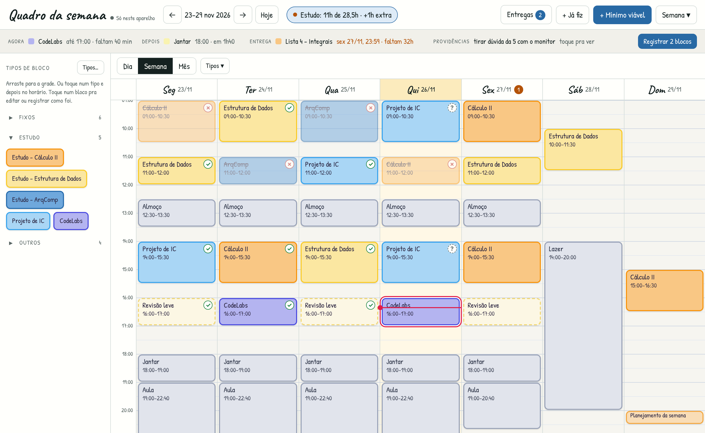
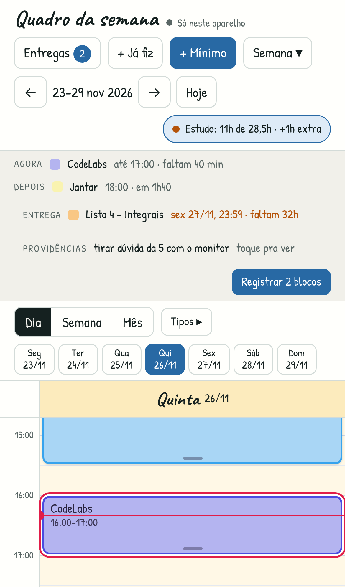
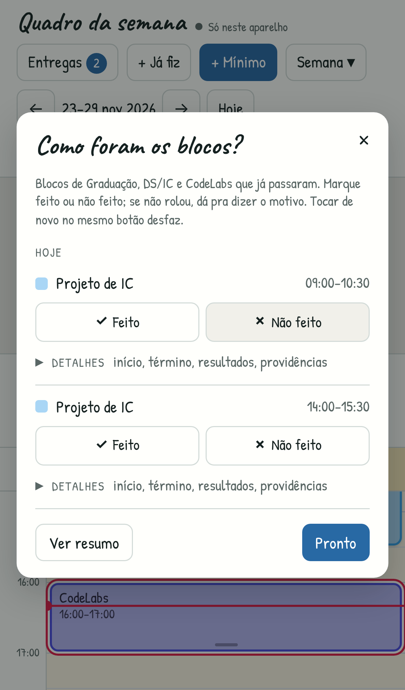
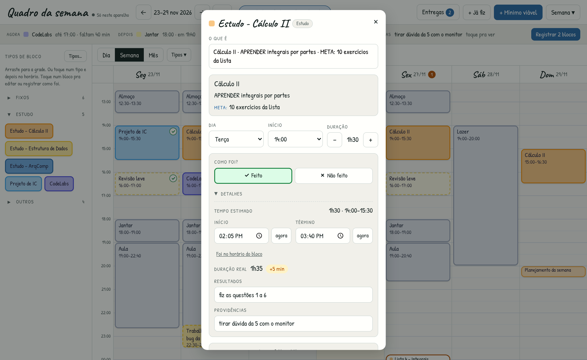
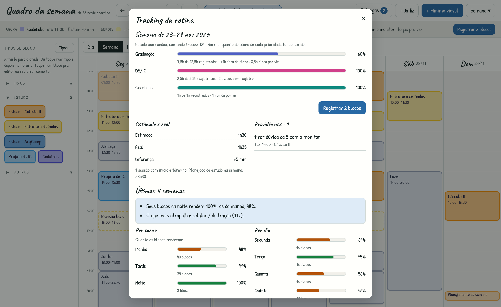
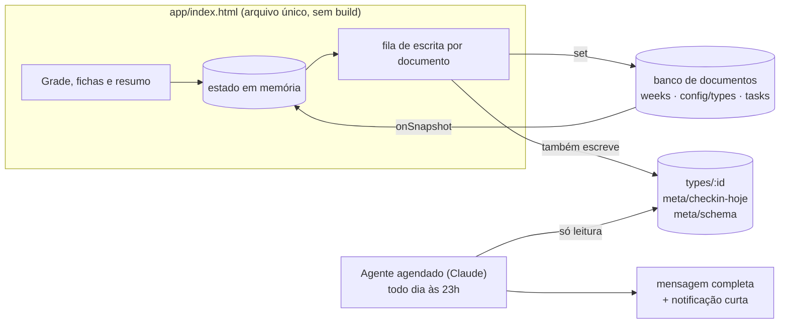
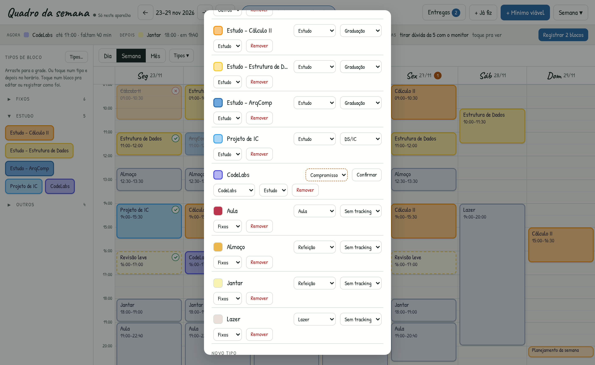

# Quadro da semana

**Um cronograma semanal de arrastar e soltar que eu uso todo dia para organizar estudo e rotina, com tracking do que foi feito e um check-in noturno feito por IA que lê os meus dados.**


[](https://github.com/davivi-py/cronograma-semanal/actions/workflows/testes.yml)




> As capturas usam dados fictícios de [`exemplos/semana-exemplo.json`](exemplos/semana-exemplo.json).

## Por que eu fiz

Sou estudante de Sistemas de Informação no ICMC-USP, com aula à noite. Os apps de agenda que testei eram pesados demais para o que eu precisava: ver a semana inteira de uma vez, mover blocos rápido pelo celular e, principalmente, **saber depois se o plano foi cumprido**. Planejar eu já planejava; o que faltava era olhar para trás com dados.

Então o quadro virou três coisas:

1. **um planejador** de blocos de 30 minutos, das 07:00 à 01:30;
2. **um diário de execução**: cada bloco de estudo vira *feito* ou *não feito*, com motivo, horário real e o que ficou pendente;
3. **uma fonte de dados para um agente de IA**, que toda noite lê o banco e me pergunta só o que ainda não foi registrado.

## O que ele faz

| Planejar | Acompanhar | Analisar |
|---|---|---|
| Arrastar e soltar (mouse e toque longo no celular), redimensionar, detecção de conflito | Agora / Depois com linha da hora atual | Horas feitas × planejadas na semana |
| Tipos com cor, grupo (Fixos, Estudo, Outros) e **classe** (estudo, aula, refeição…) | *Feito / Não feito* com motivo (cansaço, distração, imprevisto…) | Rendimento por turno, por dia e por tamanho de bloco |
| Visões de dia, semana e mês | Início, término, resultado e providências de cada sessão | Estimado × real e lista de providências |
| Entregas com prazo, inclusive coladas direto do Moodle | **+ Já fiz** para estudo fora do plano (conta como extra) | Frases automáticas, como "o que mais atrapalha: celular / distração (11x)" |
| **Mínimo viável**: encaixa 20 min no primeiro horário livre | Lista "Registrar N blocos" com tudo que passou sem registro | Últimas 4 semanas |

<table>
  <tr>
    <td width="33%"></td>
    <td width="33%"></td>
    <td width="33%"></td>
  </tr>
  <tr>
    <td align="center">Celular: visão do dia</td>
    <td align="center">Registrar o que passou</td>
    <td align="center">Ficha do bloco (estimado × real)</td>
  </tr>
</table>



## Como funciona



O quadro roda como um Artifact no claude.ai, que entrega um banco de documentos compartilhado entre os meus aparelhos. Sem esse banco (abrindo o arquivo direto no navegador), ele cai para `localStorage` e funciona igual, só que num aparelho.

Algumas decisões que valeram a pena:

- **Um arquivo, zero dependências.** HTML, CSS e JavaScript puros, sem build. Abre em qualquer navegador e é fácil de publicar.
- **Fila de escrita por documento.** Cada semana é um documento. Edições rápidas em sequência se juntam numa escrita só, e um *snapshot* do servidor não sobrescreve uma escrita minha que ainda está a caminho.
- **Nada some no meio do gesto.** Atualizações que chegam de outro aparelho enquanto eu arrasto ou redimensiono um bloco ficam guardadas e só entram quando eu solto.
- **Dia lógico.** O quadro vai até 01:30, então entre 00:00 e 06:59 o "hoje" ainda é o dia anterior, no quadro, no tracking e no check-in.
- **Celular primeiro.** Pointer Events em vez do drag-and-drop do HTML5: toque curto abre, toque longo arrasta. Modo escuro automático, foco visível e `prefers-reduced-motion`.
- **Compatível com dados antigos.** Campos novos são opcionais; blocos e registros de versões anteriores (inclusive estados que não existem mais, como *parcial*) continuam abrindo e contando.

## Integração com IA: o check-in noturno

Toda noite uma tarefa agendada do Claude lê o banco do quadro e me manda um check-in curto: o que ficou sem registro hoje e o que ainda falta anotar do dia.

### Estudo de caso: quando o agente cobrou uma aula

Na primeira semana, o agente me cobrou o registro de um bloco das 19h que era **aula**, não estudo. Investigando:

1. **Causa:** os tipos eram identificados só por UUIDs, sem nenhum campo dizendo o que cada um era. O agente, que só lê o banco e não o código, teve que **adivinhar pelo texto** do bloco.
2. **Mensagem cortada:** a resposta só ia por notificação, que corta em ~200 caracteres no iPhone.
3. **Pergunta repetida:** ele perguntava coisas que eu já tinha registrado mais cedo.

A correção foi tratar o banco como uma **API para um leitor que não vê o código**:

- cada tipo ganhou uma **classe** de um conjunto fechado (`estudo`, `aula`, `compromisso_externo`, `refeicao`, `pessoal`, `lazer`, `planejamento`), obrigatória na interface e copiada para cada bloco ao salvar;
- o que foi classificado por palpite na migração ficou marcado com `kindConfirmed: false` e ganhou um botão **Confirmar**, em vez de virar verdade em silêncio;
- o próprio quadro publica um resumo pronto do dia, para o agente não precisar refazer conta de horário nem filtrar tipo:

```json
{
  "date": "2026-11-26", "diaSemana": "quinta", "weekDoc": "weeks/2026-11-23",
  "pendentes": [
    { "titulo": "Projeto de IC", "kind": "estudo", "start": "14:00", "end": "15:30", "terminou": true }
  ],
  "registrados": [
    { "titulo": "Cálculo II", "kind": "estudo", "start": "11:00", "end": "12:00", "s": "pulei", "r": "distracao" },
    { "titulo": "CodeLabs", "kind": "compromisso_externo", "start": "16:00", "end": "17:00", "s": "feito", "kindConfirmed": false }
  ],
  "semClasse": [],
  "ignorados": [ { "titulo": "Aula", "kind": "aula", "start": "19:00" } ],
  "contagem": { "feito": 1, "pulei": 1, "pendentes": 1 }
}
```

- `meta/schema` descreve tudo isso em texto para o agente ler primeiro, inclusive a regra **"se faltar a classe, pergunte; não adivinhe"**;
- o check-in passou a sair em dois níveis: o texto completo como mensagem e só a pergunta principal na notificação.

A migração mexeu em 12 semanas de dados (que ficam fora deste repositório) numa escrita atômica, com uma checagem por script de que nenhum registro (`log`) mudou.



## Modelo de dados

Cada semana é um documento `weeks/<segunda-feira AAAA-MM-DD>`:

```json
{ "blocks": [
  { "id": "…", "typeId": "t-calc", "day": 1, "slot": 14, "minutes": 90,
    "text": "Cálculo II · APRENDER integrais por partes · META: 10 exercícios",
    "kind": "estudo", "subject": "Cálculo II",
    "log": { "s": "feito", "inicio": "14:05", "termino": "15:40",
             "resultado": "fiz as questões 1 a 6", "providencia": "tirar dúvida da 5" } }
] }
```

- `day` vai de 0 (segunda) a 6 (domingo); o início é `07:00 + slot × 30 min`.
- O texto usa ` · ` para separar partes, e `RÓTULO:` vira linha destacada na ficha.
- `log.s` é `feito` ou `pulei`; `r` é o motivo. A duração real é calculada, nunca salva.
- `extra: true` marca um bloco registrado pelo **+ Já fiz**.

Outros documentos: `config/types` (tipos, cores e paleta), `tasks/<id>` (entregas), `types/<id>`, `meta/checkin-hoje` e `meta/schema` (o contrato para o agente, descrito acima).

## Como eu construí (com IA)

Este projeto foi feito em par com o **Claude** (no claude.ai e no Claude Code). A divisão foi mais ou menos esta:

- **Eu:** defini o problema e as regras do meu dia (o que conta como estudo, o que é fixo, como quero registrar), decidi a interface, usei o quadro todo dia e voltei com o que não funcionou. Os relatos de bug e as mudanças de rumo, como o caso do check-in acima, partiram do uso real.
- **O Claude:** escreveu a maior parte do código a partir dessas especificações, propôs as soluções técnicas (fila de escrita, dia lógico, contrato do banco) e testou as mudanças no navegador antes de publicar.
- **Juntos:** cada mudança passou por especificação → implementação → teste com dados reais e fictícios → publicação, e o histórico de commits conta essa evolução.

O que eu mais aprendi foi a **especificar bem**: descrever o problema com exemplos concretos, separar fato de palpite e definir o que não pode quebrar (os registros antigos, por exemplo) antes de pedir a solução.

## Rodando localmente

Não precisa instalar nada para usar:

```bash
git clone https://github.com/davivi-py/cronograma-semanal.git
cd cronograma-semanal
# abra app/index.html no navegador
```

Para ver com dados, use **Semana ▾ → Importar backup** e escolha `exemplos/semana-exemplo.json`.

Para rodar os testes e gerar as capturas (precisa de Node 22+):

```bash
npm install
npx playwright install chromium
npm test                # 5 testes de ponta a ponta num Chromium sem interface
npm run screenshots     # refaz as imagens de docs/ com os dados de exemplo
```

Os testes abrem o quadro de verdade com o relógio fixo e um banco simulado, e conferem, entre outras coisas, que dados antigos sem classe ainda abrem e que salvar uma semana nunca altera um registro.

## Estrutura

```
app/index.html            o quadro (versão atual, arquivo único)
v1/                       primeira versão: só localStorage, drag-and-drop do HTML5
exemplos/                 semana fictícia para importar e para as capturas
tests/quadro.test.js      testes de ponta a ponta com Playwright
scripts/screenshots.js    gera as imagens do README
docs/                     capturas de tela
```

## Próximos passos

- Funcionar offline como PWA, com fila de escrita persistente.
- Exportar o histórico de registros em CSV para analisar em Python.
- Sugerir o plano da semana seguinte a partir do que rendeu nas anteriores.
